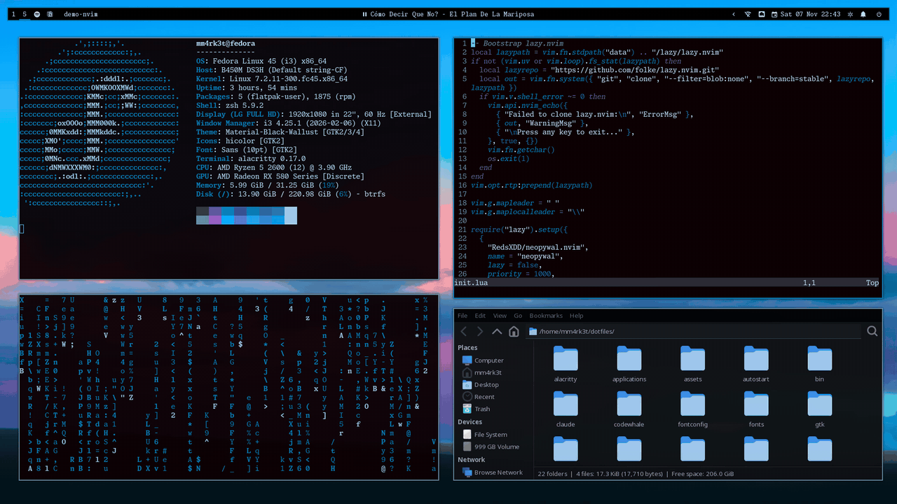

# dotfiles

My Fedora + i3 desktop: polybar, rofi, dunst, alacritty, picom, i3lock-color, zsh (oh-my-zsh) and Neovim. Colors are generated from the wallpaper by [wallust](https://codeberg.org/explosion-mental/wallust).



Light/dark mode (`theme-mode toggle`, or the sun icon in the bar) recolors i3, polybar, the terminals, Neovim and GTK apps live.

## New machine

```sh
sudo dnf install -y git
git clone git@github.com:mm4rk3t/dotfiles.git ~/dotfiles   # or: gh repo clone mm4rk3t/dotfiles ~/dotfiles
~/dotfiles/install.sh
```

Then log out and choose i3 at the login screen.

`install.sh` is safe to re-run. It:

1. Installs the packages in `packages/dnf.txt`, the COPR packages in `packages/copr.txt` (i3lock-color) and the cargo crates in `packages/cargo.txt` (wallust).
2. Installs oh-my-zsh and sets zsh as the login shell.
3. Unpacks the GTK theme from `assets/` into `~/.local/share/themes`.
4. Installs Claude Code, [engram](https://github.com/Gentleman-Programming/engram) and [Codewhale](https://github.com/codewhale-hq/Codewhale) into `~/.local/bin` (versions pinned at the top of `install.sh`, checksums verified).
5. Symlinks every config into `$HOME` with GNU stow. Existing files are moved to `~/.dotfiles-backup/<timestamp>/` first.
6. Connects engram to Claude Code (`engram setup claude-code`) and Codewhale (MCP server), and copies `system/codewhale/config.toml` if there is none.
7. Runs wallust on the default wallpaper to generate the color files.

Use `./install.sh --no-packages` to only relink configs and regenerate colors.

## Layout

Each top-level directory is a stow package that mirrors `$HOME`:

| Package     | What it holds                                         |
|-------------|-------------------------------------------------------|
| `i3`        | i3 config, wallpaper script                           |
| `polybar`   | bar config (colors come from `~/.cache/wallust`)      |
| `rofi`      | launcher config                                       |
| `alacritty` | terminal config                                       |
| `picom`     | compositor config                                     |
| `wallust`   | wallust config and the templates for every app        |
| `gtk`       | GTK 2/3 theme settings                                |
| `zsh`       | `.zshrc`                                              |
| `nvim`      | Neovim config (lazy.nvim + neopywal)                  |
| `wallpaper` | `~/Pictures/wallpapers`, the default wallpaper        |
| `claude`    | `~/.claude/CLAUDE.md`, global instructions for every agent |
| `codewhale` | Codewhale `AGENTS.md` and the engram context hook     |

## AI agents

Claude Code is the main agent; Codewhale (DeepSeek) is optional for cheap bulk work. Both share one memory, engram (`~/.engram/engram.db`, not tracked). `~/.claude/CLAUDE.md` is the single instruction file: Codewhale loads it through `instructions` in its config.

Not tracked on purpose: `~/.claude/settings.json` (holds tokens and work plugins), `~/.claude.json`, API keys and the engram database. Codewhale refuses a symlinked `config.toml`, so it lives in `system/codewhale/` and is copied once; copy changes back by hand.

## Generated files

These are written by wallust from the templates and are deliberately **not** tracked. To change them, edit the template in `wallust/.config/wallust/templates/`:

- `~/.config/i3/colors.conf`
- `~/.config/i3/scripts/lock.sh`
- `~/.config/rofi/colors-rofi.rasi`
- `~/.config/dunst/dunstrc`
- `~/.cache/wallust/*` (alacritty, polybar, neovim)

## Adding things

- New config: copy it into the matching package (or a new one), add new packages to `STOW_PACKAGES` in `install.sh`, then run `./install.sh --no-packages`.
- New program: add it to `packages/dnf.txt`.
